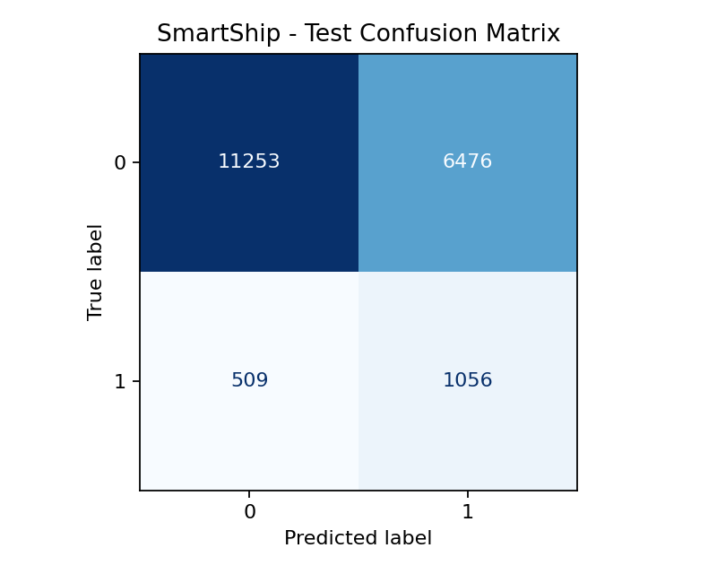
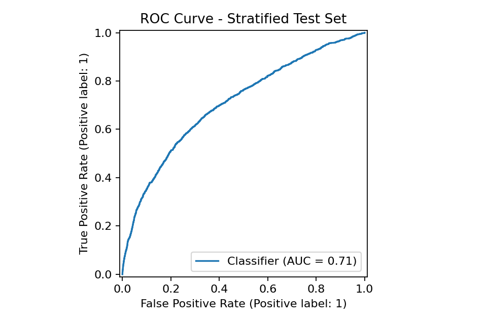
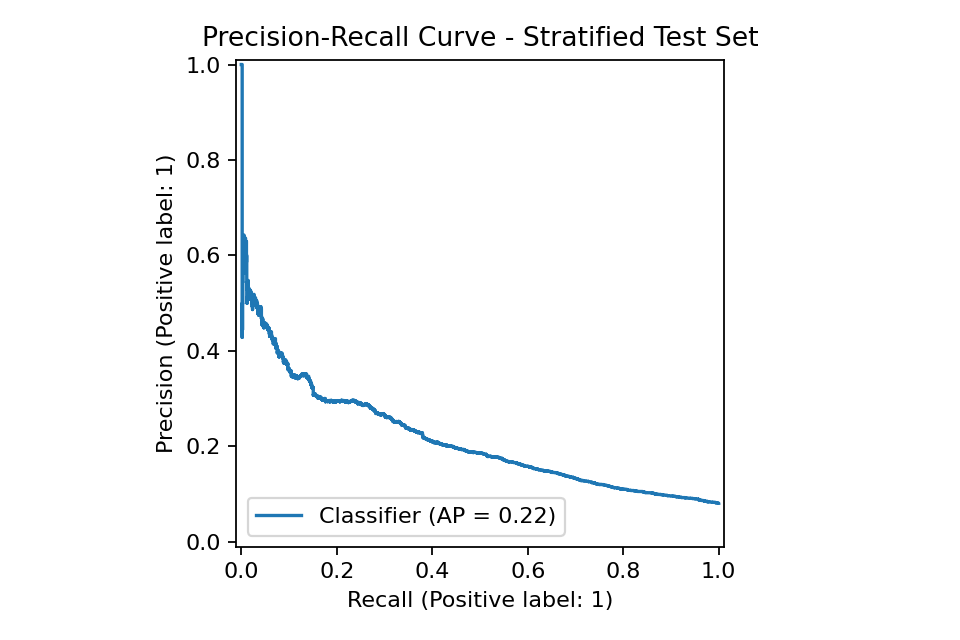
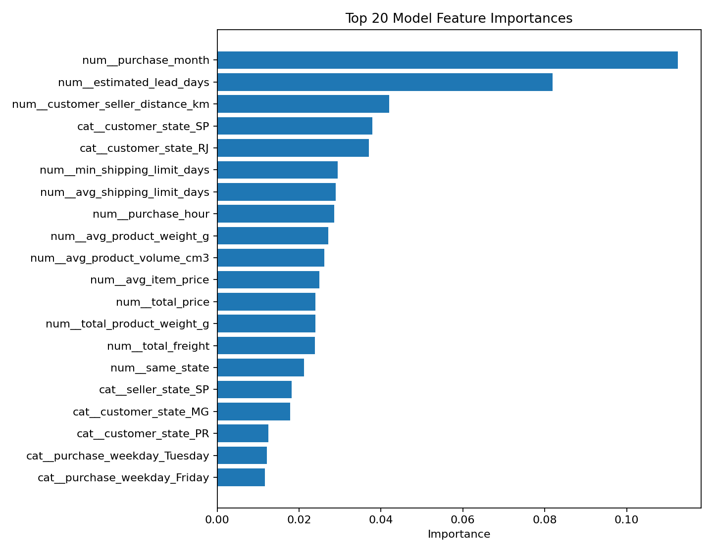

# SmartShip – E-commerce Delivery Risk Intelligence

SmartShip is a machine-learning project that estimates whether an e-commerce order is likely to arrive later than its estimated delivery date. It uses the public **Brazilian E-Commerce Public Dataset by Olist** and provides a Streamlit interface for order-level risk estimation.

## Problem
Late deliveries can reduce customer satisfaction and increase support workload. SmartShip frames this as a binary classification task:

- `1` – actual customer delivery timestamp is later than the estimated delivery timestamp.
- `0` – delivered on or before the estimated delivery timestamp.

The label is available only for delivered orders with both timestamps. Orders without an observed delivery outcome are excluded from supervised training.

## Dataset
The project uses the nine Olist CSV tables. The raw files are intentionally excluded from Git history by `.gitignore`; download the dataset from Kaggle and place the CSV files in `data/raw/` using their original filenames:

`olist_customers_dataset.csv`, `olist_geolocation_dataset.csv`, `olist_order_items_dataset.csv`, `olist_order_payments_dataset.csv`, `olist_order_reviews_dataset.csv`, `olist_orders_dataset.csv`, `olist_products_dataset.csv`, `olist_sellers_dataset.csv`, and `product_category_name_translation.csv`.

Source: https://www.kaggle.com/datasets/olistbr/brazilian-ecommerce

## Leakage prevention
The prediction moment is order placement. The model does **not** use actual delivery timestamps, carrier delivery timestamps, review scores/comments, order status, or any other post-outcome field as a predictor. Actual delivery date is used only to construct the target. One-to-many order item records are aggregated to one order row before modeling. The primary final holdout is a reproducible stratified 80/20 split. A separate chronological holdout was also explored during development; it showed a strong distribution shift and substantially weaker performance, so the project does not claim proven future-period generalization. This limitation is documented for interpretation.

## Features
Order-level features include item count, item price and freight aggregates, number of sellers/products, product weight/volume summaries, dominant product category, customer/seller state, purchase hour/day/month, weekend indicator, estimated lead time, and time until seller shipping deadline. Numeric missing values are imputed inside the model pipeline; categorical values are imputed and one-hot encoded inside the pipeline.

## Setup
Python 3.11+ is recommended (the included model artifact was trained with scikit-learn 1.8.0).

```bash
python -m venv .venv
# Windows PowerShell
.\.venv\Scripts\Activate.ps1
python -m pip install --upgrade pip
pip install -r requirements.txt
```

## Reproduce
Run commands from the repository root:

```bash
python -m src.data.validate_data
python -m src.data.profile_data
python -m src.features.build_dataset
python -m src.models.train
```

Training compares a majority-class baseline, Logistic Regression, Random Forest, and Extra Trees. Candidate performance is assessed with 3-fold stratified cross-validation on a reproducible 12,000-row sample drawn from the training partition to keep execution practical. The strongest model family is tuned using training-only CV. The classification threshold is selected from out-of-fold training predictions. The final stratified holdout is evaluated once after model selection.

Artifacts:

- `data/processed/smartship_modeling_dataset.csv` – order-level modeling table.
- `models/smartship_pipeline.joblib` – fitted preprocessing + classifier pipeline.
- `reports/results/cross_validation_results.csv` – CV F1 summary.
- `reports/results/evaluation_summary.json` – test metrics and confusion matrix.
- `reports/results/test_predictions.csv` – test-set predictions.
- `reports/results/feature_importance.csv` – tree-model feature importance (associational, not causal).
- `reports/figures/` – confusion matrix, ROC, precision-recall, and feature-importance plots.

### Key result figures









## Modeling notebooks

- `notebooks/02_eda.ipynb` – data profiling, target analysis, monthly patterns, purchase-time analysis, and order-level descriptive comparisons.
- `notebooks/03_modeling_and_evaluation.ipynb` – loads the generated dataset/model/report and displays final metrics, feature importance, and evaluation plots. Run the dataset build and training commands first.

## Run the app
After training:

```bash
streamlit run app/main.py
```

The app asks for order-time information and displays the estimated late-delivery probability and the model's classification at a 0.50 threshold.

## Evaluation
Because late orders are a minority class, accuracy alone is insufficient. The current saved run reports:

| Metric | Test result |
|---|---:|
| Accuracy | 63.80% |
| Precision (late) | 14.02% |
| Recall (late) | 67.48% |
| F1 (late) | 23.22% |
| ROC-AUC | 0.7081 |
| PR-AUC | 0.2150 |

The majority-class baseline has 91.89% accuracy but zero recall for late orders. SmartShip captures more late orders at the cost of false positives; at the selected threshold, the confusion matrix is `[[11253, 6476], [509, 1056]]` (TN, FP, FN, TP). All values are generated by `src/models/train.py` and are recorded in `reports/results/evaluation_summary.json`.

## Limitations
- Training labels are available only for delivered orders, so cancelled, unavailable, and still-in-transit orders are not modeled.
- Historical Olist data (2016–2018) may not reflect present-day logistics conditions.
- State-level location and order-level aggregates are coarse proxies; actual route, carrier, and real-time capacity data are unavailable.
- A probability estimate is not a delivery guarantee. In development, a chronological holdout experiment had a ROC-AUC close to 0.50, indicating that the model's ability to generalize to a later period is weak under temporal distribution shift. The stratified holdout results should therefore be interpreted as within-dataset discrimination, not proof of production readiness. Operational use would require recent data, time-based validation, probability calibration, monitoring, and periodic retraining.

## Repository structure

```text
SmartShip/
├── app/main.py
├── data/raw/                 # downloaded separately; excluded from Git
├── data/processed/           # generated; excluded from Git
├── models/                   # trained model artifact
├── notebooks/                # EDA notebook
├── reports/figures/          # generated plots
├── reports/results/          # generated metrics and predictions
├── src/data/                 # loading and validation
├── src/features/             # order-level feature construction
├── src/models/               # model training and evaluation
└── tests/                    # project tests
```

See [DEPLOYMENT.md](DEPLOYMENT.md) for Streamlit Community Cloud deployment and [reports/LinkedIn_post.md](reports/LinkedIn_post.md) for a project announcement draft.

## Presentation

The 11-slide project presentation is available at [`docs/SmartShip_Presentation.pptx`](docs/SmartShip_Presentation.pptx).
